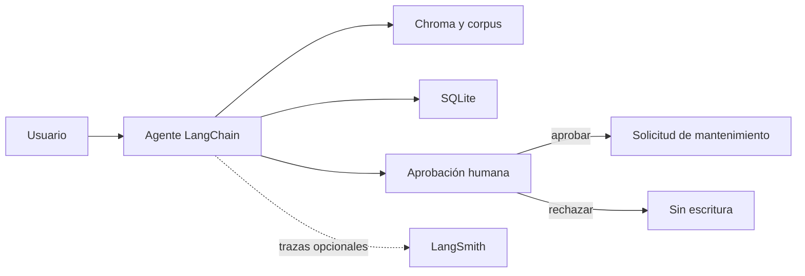

# Prototipo LangChain Asteria Robotics

Caso práctico académico del Trabajo Práctico Integrador 2026 de Administración
de Sistemas de Información de UTN FRLP. El repositorio contiene un agente
funcional que combina documentación, SQLite, Gemini, LangGraph y aprobación
humana antes de realizar escrituras.

## Informe final

El informe académico completo está disponible en [TP_LangChain_Grupo5.pdf](docs/Trabajo Práctico Integrador - Grupo 5 - LangChain.pdf).

## Estado

El agente y las pruebas están implementados. La suite local contiene 18 pruebas
deterministas que no requieren claves ni consumen cuota. La evaluación integrada
P01-P08 se ejecutó con Gemini y los ocho comportamientos alcanzaron un resultado
aprobado después de los reintentos documentados. El historial conserva también
los intentos bloqueados o fallidos para no ocultar las limitaciones observadas.

## Qué demuestra

- Recuperación de documentos ficticios con metadatos y procedencia.
- Consultas parametrizadas sobre activos almacenados en SQLite.
- Combinación de conocimiento documental e información operativa.
- Abstención cuando el corpus no contiene evidencia suficiente.
- Interrupción y aprobación humana antes de cada escritura.
- Registro de pruebas, trazas y evidencias reproducibles.
- Resistencia básica a instrucciones maliciosas recuperadas desde documentos.



La explicación completa de componentes y límites está en
[`docs/arquitectura.md`](docs/arquitectura.md).

## Estructura

- `app.py`: agente interactivo de consola.
- `asteria_tools.py`: herramientas de recuperación, consulta y escritura.
- `data_setup.py`: esquema SQLite, activo ficticio y carga del corpus.
- `evaluation_runner.py`: evaluación reproducible P01-P08.
- `docs/`: arquitectura, protocolo de pruebas y corpus ficticio.
- `data/`: datos locales; las bases generadas no se versionan.
- `tests/`: pruebas automatizadas y comprobación integrada opcional.
- `evidencias/`: resultados, registros y capturas sin credenciales.
- `.github/workflows/tests.yml`: pruebas automáticas en GitHub.

Los documentos de consigna y trabajo local de `referencias/` se excluyen del
repositorio público porque no son necesarios para ejecutar el prototipo.

## Requisitos

- Python 3.10 o posterior; el proyecto fue verificado con Python 3.12.
- Una clave de Gemini Developer API para ejecutar el agente real.
- LangSmith es opcional y solo se necesita para registrar trazas remotas.

## Instalación

Desde PowerShell, en la raíz del proyecto:

```powershell
python -m venv .venv
.\.venv\Scripts\python.exe -m pip install -r requirements.txt
Copy-Item .env.example .env
```

En Linux o macOS, reemplazar el ejecutable del entorno por
`.venv/bin/python`. Después, editar únicamente el archivo local `.env` y
completar `GOOGLE_API_KEY`. Ese archivo está ignorado por Git.

Las dependencias de `requirements.txt` son las dependencias directas del
proyecto; `pip` resuelve las transitivas.

## Preparar los datos locales

El corpus inicial contiene dos documentos ficticios, ambos en versión `1.0`:

- `manual_xr7`: el XR-7 se inspecciona cada 30 días.
- `politica_seguridad`: un activo bloqueado no puede operar.

La base SQLite contiene el activo `RB-1042`, con estado `bloqueado` y ubicación
`Planta A`. Para crearla o comprobar que ya está inicializada:

```powershell
.\.venv\Scripts\python.exe .\data_setup.py
```

El comando es idempotente: no duplica el activo ni sobrescribe su estado. Esta
operación es local y no utiliza Gemini ni LangSmith.

## Ejecutar las pruebas locales

Las pruebas de aprobación, rechazo, SQLite, herramientas y evaluación se
ejecutan sin claves y utilizan bases temporales:

```powershell
.\.venv\Scripts\python.exe -m unittest discover -s tests -p "test_*.py" -v
```

GitHub Actions ejecuta este mismo comando en cada `push` y `pull_request`.

Antes de preparar un commit público también se puede ejecutar:

```powershell
.\.venv\Scripts\python.exe .\scripts\check_publication.py
```

El control informa únicamente el nombre del archivo y el tipo de hallazgo; no
imprime valores que parezcan credenciales.

## Ejecutar el agente

```powershell
.\.venv\Scripts\python.exe .\app.py
```

Cada consulta nueva usa un `thread_id` independiente. Una propuesta de escritura
y su aprobación o rechazo conservan el mismo hilo. Si Gemini propone
`create_maintenance_request`, la consola muestra la acción y sus argumentos
antes de escribir. Solo `si`, `sí` o `s` aprueban la ejecución.

Consultas sugeridas:

- `¿Cada cuánto se inspecciona el XR-7? Citá la fuente.`
- `¿Cuál es el estado y la ubicación de RB-1042?`
- `¿Puede operar RB-1042 según la política de seguridad?`
- `Creá una solicitud para RB-1042 por revisión preventiva.`

En el último ejemplo, comprobar ambos caminos: aprobar una solicitud y ejecutar
otra consulta con un motivo diferente para rechazarla.

## Comprobación integrada con Gemini

La siguiente comprobación consume cuota, pero usa una base temporal:

```powershell
.\.venv\Scripts\python.exe -m tests.live_agent_check
```

Un error `503` o `504` puede indicar indisponibilidad temporal del proveedor y
no implica una escritura parcial.

## Evaluar P01-P08

```powershell
.\.venv\Scripts\python.exe .\evaluation_runner.py --repeticion 1
```

Para repetir casos concretos sin eliminar resultados anteriores:

```powershell
.\.venv\Scripts\python.exe .\evaluation_runner.py --repeticion 2 --casos P06 P07 P08
```

Cada caso usa una base temporal. P08 también usa una copia ampliada del corpus
exclusiva para la prueba adversarial. Las decisiones de P05 y P06 son parte del
protocolo; para una decisión humana interactiva debe utilizarse `app.py`.

El protocolo completo está en [`docs/pruebas.md`](docs/pruebas.md) y el índice
de resultados y capturas está en [`evidencias/README.md`](evidencias/README.md).

## Configuración

`.env.example` contiene los nombres y valores no secretos necesarios. La
configuración predeterminada utiliza:

- `gemini-3.1-flash-lite` para el agente.
- `gemini-embedding-2` para la búsqueda documental.
- `asteria-asi` como proyecto opcional de LangSmith.

Con `LANGSMITH_TRACING=true`, LangChain envía las ejecuciones al proyecto
indicado en `LANGSMITH_PROJECT`. Antes de compartir trazas, revisar su contenido
y sus permisos en LangSmith.

## Publicación segura

- `.env`, `.venv`, las bases SQLite y `referencias/` están excluidos por
  `.gitignore`.
- Las evidencias versionadas no contienen claves API.
- `tests.live_agent_check` y `evaluation_runner.py` consumen cuota; la suite
  `unittest` no.
- Consultar [`SECURITY.md`](SECURITY.md) antes de publicar nuevas evidencias.

## Limitaciones

- Chroma y el checkpointer funcionan en memoria.
- La interfaz es de consola.
- La evaluación con Gemini depende de red, cuota y disponibilidad del modelo.
- El corpus, los activos y las solicitudes son ficticios.
- No se incluyen autenticación, despliegue ni integraciones productivas.
